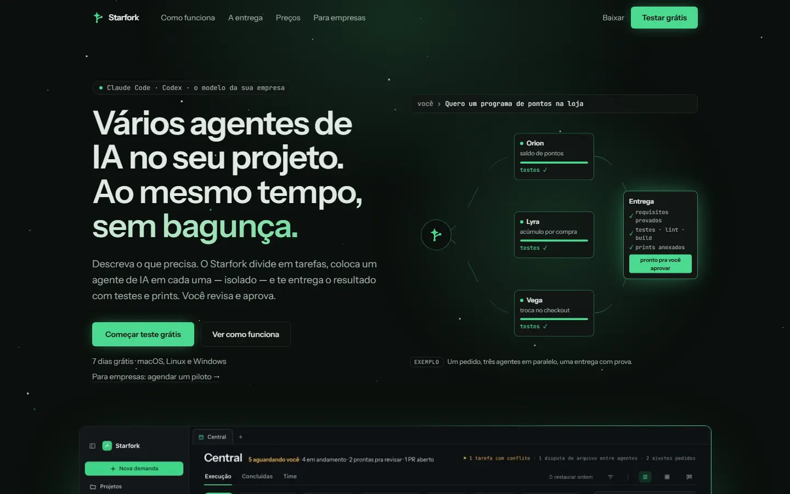
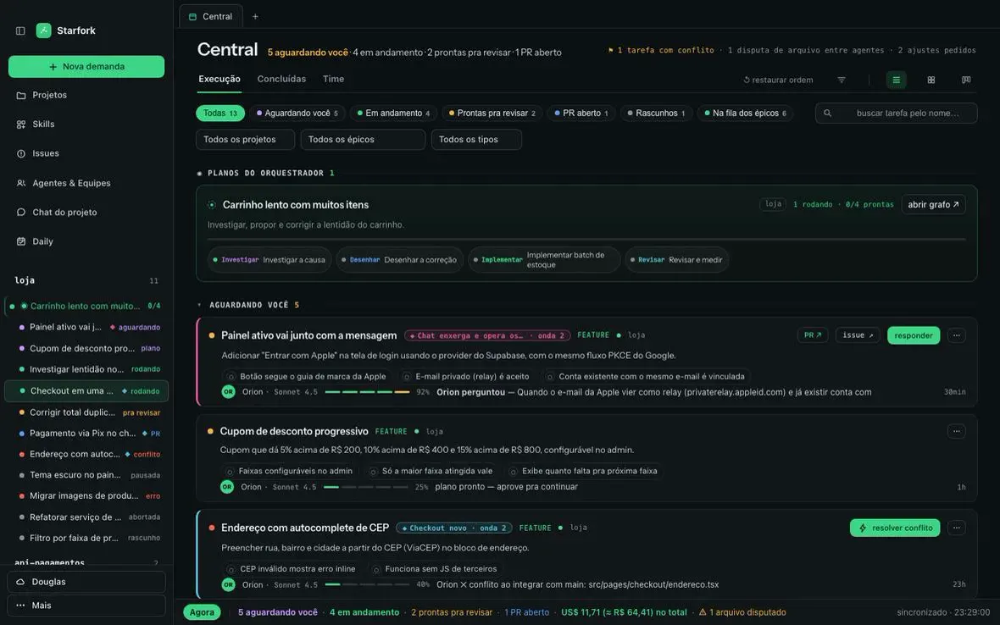
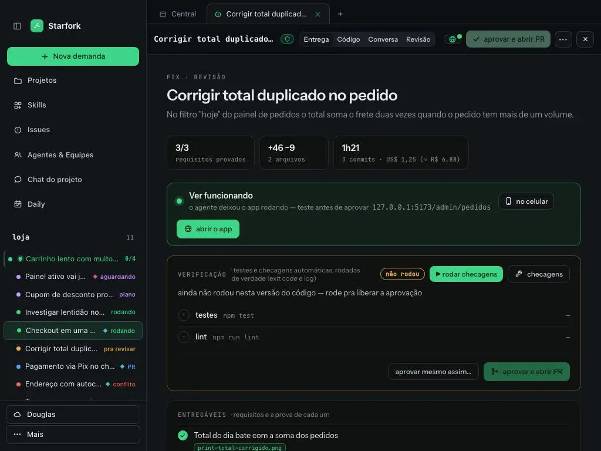

# 01 · Diagnóstico da landing, do app e da referência visual

[← voltar ao índice](README.md)

## 1. Landing atual — starfork.com.br



### Stack e identidade visual (inspecionado no HTML/CSS publicado)

| Item | Valor |
|---|---|
| Stack | React + Vite, com módulos `QueryClientProvider` e `link` (provavelmente TanStack Router/Query), e Tailwind CSS v4 |
| Fontes | **Instrument Sans** (400–700) + **JetBrains Mono** (Google Fonts) |
| Cor de acento | `--accent: oklch(79% .16 157)` (o verde da marca) |
| Raio | `--radius: .5rem`, **o padrão do shadcn/ui** |
| Demais cores | Paleta padrão do Tailwind (`--color-red-500`, `--color-amber-400`, `--color-sky-400`…) |
| Imagens | 5 prints `.webp` em `/prints/` (central, nova-demanda, agente-ao-vivo, revisao-pr, entrega) |
| Animação | Apenas pontinhos de estrela estáticos no fundo. Nenhuma biblioteca de animação |

**Por que isso importa:** quem viu muitos sites de SaaS de IA reconhece na hora a combinação "Tailwind + shadcn padrão + verde neon
sobre preto". É o visual que a maioria dos projetos gerados por IA tem, por isso a sensação de "vibecodado".

### Seção por seção

| # | Seção | O que tem | Problema | Por quê |
|---|---|---|---|---|
| 1 | Header | Logo, "Como funciona", "A entrega", "Preços", "Para empresas", Baixar, **Testar grátis** | Ok | — |
| 2 | Hero | Selo "Claude Code · Codex · o modelo da sua empresa", título "Vários agentes de IA no seu projeto. Ao mesmo tempo, sem bagunça.", 2 CTAs, "7 dias grátis" | O diagrama à direita é **estático** e marcado "EXEMPLO" | Não mostra o diferencial (prova por requisito, custo em R$). A etiqueta "exemplo" diz "isto não é real" |
| 3 | Print da Central | Imagem grande do app | Escuro, denso, pouco legível no tamanho exibido | O print devia vender, mas parece complicado |
| 4 | "Use a IA que você já tem" | 3 cards (Claude, Codex, modelo da empresa) | Ok, mas visualmente genérico | — |
| 5 | Como funciona (3 passos) | Texto + print alternados | Ritmo idêntico ao resto | Monotonia |
| 6 | "Você não recebe 'pronto'. Recebe a prova." | **A melhor copy da página** | Está enterrada na metade da página | Deveria ser o hero ou estar logo abaixo dele |
| 7 | Velocidade / Confiança / Controle | 3 colunas de bullets | Cara de template | — |
| 8 | App iPhone | Mockup de celular | Ok | — |
| 9 | Preços | Solo R$ 39,90 · Time R$ 99,90 · Organização sob consulta | Sem plano grátis; SSO e auditoria "no roadmap" | Todos os concorrentes têm plano grátis |
| 10 | CTA final + rodapé | — | **Faltam** Segurança, Enterprise, FAQ, Changelog, Sobre | São as páginas que um tech lead procura |

### O que falta (sinais de "empresa séria")

- [ ] Prova social: logos, depoimentos com nome/cargo/foto, números reais
- [ ] Página de Segurança (onde fica o código, modo protegido, o que vai pra nuvem)
- [ ] Página Enterprise e FAQ
- [ ] Changelog datado (mostra ritmo de entrega)
- [ ] Página "Sobre" (quem está por trás)
- [ ] Comparativos ("Starfork vs Conductor")
- [ ] Demo em vídeo ou animada do produto real

## 2. App (área logada)

As telas abaixo são os prints oficiais publicados na landing.

### Central de execuções



| Problema | Onde | Por que pesa | Proposta |
|---|---|---|---|
| **6+ cores de status** | Sidebar: roxo "aguardando", laranja "pra revisar", azul "PR", vermelho "conflito/erro", verde "rodando", amarelo no topo | Ninguém memoriza 6 cores; "o que precisa de mim?" se perde | 4 estados: precisa de você (âmbar), rodando (verde), pronto pra revisar (azul), problema (vermelho). O resto é cinza |
| **Card com ~8 elementos** | Título, chip de onda, tipo (FEATURE), projeto, PR ↗, issue ↗, chips de requisito, barra de progresso, motor, %, tempo, botão | Tudo com o mesmo peso | 3 níveis: título + estado / 1 linha de contexto / o resto ao expandir |
| **Mistura tipográfica** | Rótulos mono MAIÚSCULOS ("PLANOS DO ORQUESTRADOR"), sans, mono amarelo no topo ("1 tarefa com conflito · 1 disputa…") | Sem escala, parece montado aos pedaços | Escala de 5 tamanhos; mono só para código/ids |
| **Títulos truncados** | Sidebar inteira ("Carrinho lento com muito…", "Painel ativo vai j…") | Esconde a informação principal | Sidebar redimensionável + tooltip + 2 linhas |
| **Filtros duplicados** | Chips de status + 3 dropdowns + busca + 3 modos de visualização | Muita decisão antes de ver o trabalho | Filtros colapsados, com 1 linha de "atalhos salvos" |
| **Verde em vários botões** | "Nova demanda", "responder", "resolver conflito", "Agora" | Se tudo é CTA, nada é | 1 CTA primário por tela |

### Tela da tarefa — Entrega



**É a tela mais madura** e deve servir de referência para o resto: título grande, subtítulo, 3 cards de métrica (requisitos provados, diff, tempo/custo),
bloco "Ver funcionando" e verificação com estado claro ("não rodou").

Ajustes:

- O bloco de verificação tem 2 botões quase iguais ("rodar checagens" e "checagens") e 2 CTAs no rodapé. Dá para simplificar.
- "aprovar mesmo assim…" deveria ficar menos visível que "aprovar e abrir PR" (hoje os dois têm peso parecido).

### A restrição que manda no app

O `PRODUCT.md` diz: *"Fast and calm. Nothing animates or runs when it isn't visible, and the app never makes the Mac hot"* (o app já chegou a 100–200% de CPU).
Por isso **nada de three.js, partículas ou blur pesado dentro do app**. O acabamento premium no app vem de:

- consistência (tokens, escala tipográfica, 4 estados);
- espaço em branco e hierarquia;
- microinterações só em CSS (`transform`/`opacity`), pausadas quando a tela não está visível;
- respeito a `prefers-reduced-motion`.

## 3. Referência visual: kelvinbiffi.com


### Stack

| Item | Valor |
|---|---|
| Base | HTML + CSS + JS puro (sem framework), servido como estático |
| 3D | **three.js r128** (`cdnjs`), arquivo `field.js` (~7 KB) |
| Fontes | **Geist** (300–600), **Geist Mono**, **Instrument Serif** (com itálico) |
| CSS | `site.css` (~55 KB), com 17 `@keyframes` |
| JS | `site.js` (~12 KB: scroll, paleta ⌘K, contadores, i18n), `demo.js` (~5 KB: demo roteirizada do hero) |

### Tokens de design

```css
--bg: #060608;      --bg-2: #0c0c11;
--surface: rgba(20,20,27,.66);  --surface-2: rgba(28,28,38,.72);   /* vidro */
--line: rgba(255,255,255,.08);  --line-2: rgba(255,255,255,.14);
--ink: #ededf2;  --dim: #a1a1b0;  --mute: #6e6e7e;                 /* 3 níveis de texto */
--v: #8b5cf6;  --c: #22d3ee;                                       /* 2 acentos */
--amber: #f5b544;  --red: #ff6b75;  --green: #4ade80;              /* estados */
--grad: linear-gradient(100deg, #c4b5fd, #67e8f9 60%, #fff);
--r: 18px;  --r-sm: 12px;  --max: 1240px;
--gut: clamp(16px, 4vw, 40px);
--ease: cubic-bezier(.2,.7,.2,1);
```

**O que copiar da filosofia (não das cores):** só **3 níveis de texto**, só **2 acentos**, estados com cor fixa, raio generoso (18px),
uma única curva de easing para tudo e superfícies translúcidas sobre um fundo quase preto.

### Os efeitos e como funcionam

| Efeito | Como é feito | Por que funciona | Como trazer para o Starfork |
|---|---|---|---|
| **Campo de partículas que muda de forma por seção** | three.js `Points` + `BufferGeometry` + `ShaderMaterial`. Cada `<section data-field="…">` define uma forma: `sphere` (mente), `grid` (interfaces), `ring` (protocolo), `wave` (sinal), `helix` (jogos). Na rolagem, as partículas interpolam até a forma da seção. Reage ao `pointermove` | Dá continuidade à página inteira e cada forma conta algo sobre a seção | Formas com significado para o Starfork: **um ponto que se divide em ramos** (o "fork"), **várias trilhas paralelas** (agentes), **convergência** (merge), **grade** (Central). Mesmo motor, outra narrativa |
| **Serifa itálica de acento** | `Instrument Serif` itálico numa palavra do título ("*trust.*"), com o gradiente `--grad` | Contraste editorial: parece revista, não template | "sem *bagunça*.", "Recebe a *prova*." |
| **Demo roteirizada no hero** | `demo.js`: um card de chat com uma chamada de ferramenta (`crm.search_leads`, `200 · 312ms`), chips de contexto, um card de aprovação ("This sends 214 emails and cannot be undone") com diff, e o rodapé com custo (`$0.0026`), tokens (`1,870 tok`) e tempo (`2.1s`) animando. Pausa fora da tela (`IntersectionObserver`) | Mostra o produto funcionando, com dados críveis, em vez de descrever | Pedido → 3 agentes → requisitos sendo provados → card "aprovar e abrir PR", com custo em R$ e tempo subindo |
| **Revelação de texto** | Classe `.reveal` + `split` em palavras + `IntersectionObserver` | Ritmo de leitura e sensação de cuidado | Títulos das seções |
| **Contadores** | Números animam ao entrar na tela | Prova social viva | "requisitos provados", "PRs entregues" (dados reais) |
| **Vidro** | `backdrop-filter: blur(12–24px) saturate(140–150%)` em header, cards e paleta | Profundidade sobre o campo de partículas | Header e cards da landing (não no app) |
| **Paleta ⌘K "Ask or jump to…"** | `openPal`/`ask`/`askApi`: navegação e pergunta a um agente sobre o site | Sinal de produto feito por quem entende de IA | "Pergunte ao Starfork": FAQ respondido por IA na landing |
| **i18n EN/PT** | `hreflang` + rotas `/pt/` | Alcance internacional | Futuramente EN para Product Hunt/HN |
| **Acessibilidade de movimento** | `prefers-reduced-motion` em `field.js`, `site.js` e `demo.js` | Respeita quem pede menos animação | Obrigatório |

### Orçamento de performance para a nova landing

- Campo de partículas **só no desktop** e só com `prefers-reduced-motion: no-preference`; no mobile, um gradiente estático.
- three.js carregado **depois** do primeiro paint (`defer`/`import()` dinâmico).
- Pausar o `requestAnimationFrame` quando a aba ou a seção não está visível.
- Meta: **Lighthouse Performance ≥ 90** e LCP < 2,5 s.
