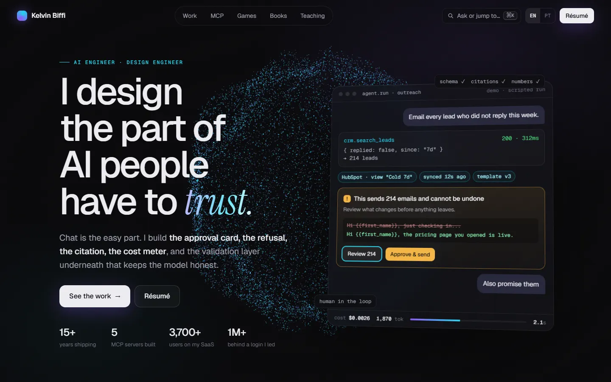

# Redesign do Starfork — análise e plano de implementação

> Proposta para a landing (starfork.com.br) e para o app (área logada).
> Pesquisa feita em 14/10/2026. Nada aqui foi implementado ainda: é para a gente decidir junto.

## Resumo em 30 segundos

O Starfork já é um produto grande e sério (orquestrador, provas por requisito, times, billing, app iOS),
mas **por fora ele parece um projeto feito no fim de semana**. O motivo não é falta de efeito visual:
é falta de **sinais de que existe uma empresa por trás** (prova social, páginas de segurança/enterprise,
changelog, demo real) e, no app, **excesso de informação competindo na tela**.

A boa notícia: nas 3 maiores reclamações sobre os concorrentes (agente que diz "pronto" sem estar,
setup de cada worktree e gasto surpresa), **o Starfork já é a resposta**, só que a landing não fala disso.

A proposta tem 5 frentes, em ordem de impacto:

1. **Landing**: mensagem construída a partir das dores reais, hero com demo animada do produto + identidade editorial + páginas de confiança.
2. **App**: design system enxuto (4 estados, escala tipográfica, menos chips) sem pesar a CPU.
3. **Produto**: fechar as lacunas que os concorrentes também têm (fila contra rate limit, real × estimado ao vivo, detectar teste alterado).
4. **Marketing e FOMO com dado real**: preço de fundador, contadores públicos, entrega compartilhável.
5. **E-mails com o Couryo**: SMTP em reais para auth + e-mails de trial e ciclo de vida.

---

## 1. Diagnóstico da landing

O que está bom e deve ficar: tema escuro com verde da marca, Instrument Sans, a copy
("Você não recebe 'pronto'. Recebe a prova.") e a estrutura de seções.

O que faz parecer amador, e **por quê**:

| Problema | Por que pesa |
|---|---|
| Prints marcados **"EXEMPLO"**, pequenos e escuros | O visitante lê "isso não é real". O produto é o nosso melhor argumento e está escondido. |
| Hero é um diagrama de nós parado | Não mostra o que só a gente faz (prova por requisito, custo em R$). Todo concorrente tem um diagrama parecido. |
| **Zero prova social** (logos, números, depoimentos, quem está por trás) | É o primeiro filtro de quem compra para um time. Sem isso, "R$ 99,90" parece risco. |
| Sem páginas de **Segurança, Enterprise, FAQ, Changelog** | São as páginas que um tech lead procura antes de levar a ferramenta para a empresa. |
| Todas as seções no mesmo ritmo (título → texto → print) ×7 | A página fica monótona e "template de SaaS de IA". |
| Fundo de pontinhos estáticos | Efeito genérico, não conta nada sobre o produto. |

### Referência: kelvinbiffi.com

O que torna essa página premium, e que dá para trazer:

- **Campo de partículas 3D (three.js) que muda de forma por seção** (esfera → grade → anel → onda → hélice) e reage ao mouse. Dá continuidade e "vida" sem atrapalhar a leitura.
- **Tipografia editorial**: sans grande + **serifa itálica de acento** (Instrument Serif) em uma palavra-chave ("*trust.*").
- **Demo roteirizada** no hero, com dados críveis (custo, tokens, latência, card de aprovação). Mostra o produto em vez de descrever.
- Revelação de texto em partes, contadores, vidro com blur, busca ⌘K, i18n EN/PT.
- **Respeita `prefers-reduced-motion`** — o efeito some para quem pede menos animação.

## 2. Diagnóstico do app (área logada)

A tela de **Entrega** já é a mais madura (hierarquia clara, cards de métrica, verificação).
A **Central** concentra os problemas:

| Problema | Por que pesa |
|---|---|
| **6+ cores de status** (roxo, laranja, azul, vermelho, verde, amarelo) | Ninguém memoriza 6 cores. Vira ruído e o "o que precisa de mim?" se perde. |
| Card com ~8 elementos competindo (chips de requisito, onda, tipo, projeto, PR, issue, barra, motor, tempo) | Tudo tem o mesmo peso, então nada se destaca. |
| Mistura de estilos: mono MAIÚSCULO + sans + vários cinzas + amarelo mono no topo | Sem escala tipográfica fixa, a tela parece montada aos pedaços (é a sensação de "vibecodado"). |
| Títulos truncados em toda a sidebar | Passa sensação de aperto e esconde a informação principal. |
| Verde primário em muitos botões ao mesmo tempo | Se tudo é CTA, nada é CTA. |

**Restrição importante (PRODUCT.md):** o app tem que ser "rápido e calmo" — já chegou a 100–200% de CPU.
Então **efeitos pesados (three.js, partículas) ficam só na landing**. No app, o acabamento vem de
consistência e microinterações baratas em CSS.

## 3. O que os concorrentes fazem

| Concorrente | O que passa seriedade | Ideia para o Starfork |
|---|---|---|
| **Conductor** (YC) | Changelog datado na home, SOC 2, página Enterprise, "100k+ builders" | Changelog na home; presença de quem está ativo no time |
| **Superset** | Logos, 11 depoimentos, 15k stars, FAQ, páginas "Superset vs X" | Faixa de confiança + página comparativa |
| **Orca** (YC) | Tabela comparativa, FAQ, depoimentos | Comparativo "Starfork vs …" |
| **Devin / Factory / Warp** | Hero = UI real terminando em "PR pronto, testei no browser"; custo por PR; cases | Hero com a nossa Entrega real; métrica de custo por entrega |
| **Vibe Kanban** | Status que avança sozinho (agente começou, PR abriu, PR mergeou) | Automação de status na Central |
| Vibe Kanban, Crystal, Terragon | **Descontinuados ou viraram outro produto** | O mercado está consolidando: é hora de parecer o player sério |

**Preço:** todos têm plano **grátis permanente**; Pro entre US$ 20 e 50 por usuário; Enterprise "fale conosco".
Nós temos só trial de 7 dias, o que diminui quem experimenta.

**O que só o Starfork tem** (e a landing deve gritar): prova por requisito com gate,
plano em épicos/ondas, custo estimado em R$ antes de rodar, Windows/Linux/macOS e app iOS para responder agentes.

## 4. Do que os usuários reclamam nos concorrentes (e como a gente ganha)

Pesquisa em threads do Hacker News, issues do GitHub, fóruns oficiais e Trustpilot, mais menções no Reddit/X e
anúncios ativos via Viral Recast (no fim desta seção). Os links estão nas tabelas.
Algumas reclamações são do próprio Claude Code/Codex, que todo orquestrador herda.

| # | Reclamação | Frequência | Onde aparece | O Starfork já resolve? |
|---|---|---|---|---|
| 1 | **"O agente disse pronto, mas está quebrado"**, inclusive testes "passando" que falharam | Muito alta | Claude Code ([#46940](https://claudeissues.com/issue/46940-claude-fabricates-test-results-reports-all-passed-when-tests-are-failing)), Devin ([Answer.AI: 3 de 20 tarefas](https://www.answer.ai/posts/2025-01-08-devin)), Vibe Kanban | **Sim**: prova por requisito + gate + "rodar checagens" fora do agente |
| 2 | **Setup de cada worktree**: `.env`, portas, `node_modules`, banco | Muito alta | Superset, Conductor, Claude Squad ([HN](https://news.ycombinator.com/item?id=46368739)) | **Quase**: `.env` copiados, `node_modules` linkados, porta livre e `RUNBOOK.md` (`src/env-up.ts`). Falta banco por worktree |
| 3 | **Gasto surpresa** ("Pro consumido em 10 min", "2.500 requests sumiram") | Muito alta | [Cursor](https://forum.cursor.com/t/pro-plan-burned-in-10-minutes-by-background-agent-calls-completely-unacceptable/118368), [Warp](https://nz.trustpilot.com/review/warp.dev), Factory | **Sim**: estimativa em R$ antes de rodar + teto por tarefa |
| 4 | **Revisão vira gargalo**: "o gargalo é quão rápido eu reviso" | Alta | Todos ([Simon Willison](https://simonwillison.net/2025/Oct/5/parallel-coding-agents/)) | **Parcial**: a Entrega organiza por requisito |
| 5 | **Conflito de merge entre agentes** | Alta | Todos | **Parcial**: o barramento de claims já evita parte dos conflitos e a Central mostra "arquivo disputado" |
| 6 | **Só Mac** ou Windows quebrado | Alta | Conductor (só Apple Silicon), Superset, Claude Squad, Orca | **Sim**: Tauri em macOS, Windows e Linux |
| 7 | **Rate limit (429)** com vários agentes em paralelo | Alta | Claude Code ([#46037](https://claudeissues.com/issue/46037-bug-anthropic-api-error-429-rate-limit-with-multiple-parallel-sessions-below-usa)), Cursor | **Não**: hoje só mostra "espere e tente de novo" (`src/ai-once.ts`) |
| 8 | **Privacidade**: código na nuvem, telemetria ligada por padrão, permissões amplas | Média | Cursor (exigia privacy mode desligado), Vibe Kanban | **Parcial**: o código fica local |
| 9 | **Comando destrutivo** (`dropdb`, `terraform destroy`) | Média, mas grave | Claude Code ([#45463](https://claudeissues.com/issue/45463-claude-code-executed-destructive-database-operation-without-user-approval)) | **Sim**: modo protegido |
| 10 | **App pesado e ferramenta que morre** | Média | Sculptor (Electron pesado parado), [Vibe Kanban encerrou](https://vibekanban.com/shutdown), Crystal descontinuado | **Parcial**: Tauri é mais leve. Falta exportar dados |

**O que isso significa:** nas 3 reclamações mais frequentes (agente que mente, setup e gasto), **o Starfork já é
a resposta**, e a landing não diz isso com essas palavras. A mensagem principal deve sair daqui.

### Lacunas de produto que viram vantagem

| Lacuna | Proposta | Por quê |
|---|---|---|
| Rate limit (#7) | Fila com concorrência adaptativa: ao receber 429, segura os próximos agentes e retoma sozinho. Oferecer troca para outro motor (Codex/DeepSeek) com um clique | Reclamação frequente e ninguém resolve. Combina com "vários agentes" |
| Agente que mexe no teste (#1) | O gate checa se o agente **alterou testes ou asserts** e mostra isso na revisão | Fecha a brecha do "teste forjado" |
| Gasto (#3) | Mostrar **real × estimado ao vivo** e pausar a tarefa ao atingir 80% do teto | Transforma a estimativa em garantia |
| Conflito (#5) | Avisar a sobreposição **durante** a execução e sugerir a ordem de merge | "Saiba antes, não depois" |
| Banco por worktree (#2) | Snapshot ou template de banco por tarefa | Última peça do setup |
| Continuidade (#10) | Exportar tudo (demandas, provas, memória) | Responde ao medo de "e se a empresa acabar?" |

### Mensagens prontas a partir das dores

- *"Seu agente disse 'feito'. O Starfork pede a prova."* (dor #1)
- *"Você sabe quanto vai custar antes de apertar Enter. Em reais."* (dor #3)
- *"Cada agente na sua cópia do projeto, com `.env`, dependências e porta próprios. Sem configurar nada."* (dor #2)
- *"Agentes em paralelo também no Windows e no Linux."* (dor #6). Vale uma página "Alternativa ao Conductor para Windows".
- *"O agente não apaga o seu banco."* Em vídeo, o modo protegido bloqueando os comandos dos incidentes reais (dor #9).
- *"Revise provas, não 2.000 linhas de diff."* (dor #4)

### O que as redes mostram (Viral Recast, 14/10/2026)

Menções no Reddit e no X (últimos 12 meses), anúncios ativos (Meta, Google, LinkedIn) e conteúdo em alta no Brasil.

**Menções: o que as pessoas dizem**

- **Conductor é o mais citado** como resposta para "como rodar vários Claude Code ao mesmo tempo?". Elogiam a UI e os worktrees automáticos.
  A crítica principal é **segurança**: *"Agents run directly on your system without sandboxing"* (FAQ deles), e um usuário
  [parou de usar por isso](https://www.reddit.com/r/conductorbuild/comments/1t0875l/approvals_and_sandboxing/). → **Nosso modo protegido responde a isso.**
- **Superset tem fãs fiéis**: *"game changer"*, *"I rarely open WebStorm these days"*. O que elogiam: **avisa quando o agente precisa de você**,
  sessões que sobrevivem ao reiniciar, é grátis e roda no Windows. O **fundador responde pessoalmente nos threads** do Reddit.
- **Mudança de preço da Anthropic (15/06)**: usuários relatam que `claude -p` e o Agent SDK deixaram de consumir a assinatura e passaram a usar
  créditos ([r/conductorbuild](https://www.reddit.com/r/conductorbuild/comments/1txiqp6/conductor_strategy_wrt_anthropics_15th_of_june/),
  [r/programare](https://www.reddit.com/r/programare/comments/1tt2jbt/termicdev_inlocuitor_conductorbuild_open_source/)). Clones como o Termic
  nasceram rodando o CLI oficial num PTY por causa disso. **O nosso Modo Terminal (`src/terminal.ts`) já faz isso.** ⚠️ Confirmar qual modo é o padrão,
  porque a landing promete "usa sua assinatura".
- **Mercado lotado de clones** (Tempest, Termic, herdr, T3 Code, Emdash, Polyscope, JetBrains Air, Zed com agentes paralelos, Devin Desktop).
  Um comentário resume: *"Basically the same thing… vote with your wallet"*. **Orquestrar worktrees virou commodity**: o diferencial
  precisa ser a prova, o gate, o time e o Brasil.
- **Dores que se repetem**: *"A clean git merge of my two agents' worktrees that failed its own tests"* (conflito semântico),
  agentes que burlam testes e *"Codex burnout"*, de quem não lembra mais o código que "entregou".
  → Ideias de produto: **gate de integração** depois do merge e um **resumo do que mudou** para a pessoa continuar entendendo o próprio código.
- **No Brasil (r/brdev, r/MicroSaaSBR)**: os devs já conhecem Conductor e Orca. O Orca é elogiado pelo **app de celular**. Ninguém citou o Starfork.

**Anúncios: quem paga e como**

| Quem | O que vimos | O que aprender |
|---|---|---|
| **Conductor** | **Zero anúncios** em Meta, Google e LinkedIn | Cresceu só por indicação (Reddit, YC). O boca a boca funciona neste nicho |
| **Devin** | ~150 anúncios no Meta e ~500 no Google. Vários no ar há **97–118 dias** com 6–7 variações (sinal de que convertem) | (1) **Vídeo de criador (UGC)** com *"comente DEVIN que eu te mando o link"*; (2) anúncio de busca **"Cursor AI Alternative"** levando para `devin.ai/cursor` |
| **Brasil, "agentes de IA programação"** | 53 anúncios, **todos de cursos** (Hashtag, Alura, Asimov, PUC). **Nenhum produto concorrente anunciando** | **O espaço pago no Brasil está livre.** E os criadores de IA brasileiros já têm a audiência certa |

**Conteúdo em alta no Brasil**: criadores pequenos com muito alcance falando de Claude Code, como
[Felipe Tâmbara](https://www.tiktok.com/@felipetambara/video/7692456982581759253) (1,8 mil seguidores, 13 mil views, 312 comentários com "comente X")
e [Rodrigo Tadewald](https://www.tiktok.com/@rodrigotadewald/video/7695805193274854664) (Asimov). Um vídeo gringo sobre **rate limit**
(*"Claude, what time do you reset?"*) passou de 42 mil views em 1 dia, o que confirma a dor #7.

**O que fazer com isso:**

1. **Parcerias com 3–5 criadores BR de Claude Code** no formato que já converte para o Devin (vídeo curto + "comente STARFORK").
2. **Google Ads de conquista**: "alternativa ao Conductor para Windows", "Conductor em português" e "Superset alternativa".
3. **Founder-led no Reddit e no TabNews**: o Douglas respondendo threads de "qual orquestrador vocês usam?", como o fundador do Superset faz.
4. **Mensagem de segurança contra o Conductor**: "Agentes com modo protegido. O Conductor roda sem sandbox."

---

## 5. Plano de implementação

### Fase 0 — Higiene (este PR)

- [x] Tirar o `.mcp.json` do git e adicionar `.mcp.json.example`.
  **Por quê:** o `.mcp.json` já estava no `.gitignore`, mas continuava versionado. Quem quiser adicionar um
  MCP com API key corria o risco de commitar a chave.
  **Atenção:** depois do pull, o `.mcp.json` some da máquina de vocês. Para recriar: `cp .mcp.json.example .mcp.json`.
- [x] Este documento.

### Fase 1 — Landing: confiança (1–2 semanas) · maior impacto, menor risco

| Item | Por quê | Pronto quando |
|---|---|---|
| Trocar os prints "EXEMPLO" por capturas reais grandes e nítidas, com zoom ao clicar | O produto é o argumento mais forte | Nenhuma imagem marcada como exemplo; prints em 2x |
| Faixa de confiança abaixo do hero: números **reais** (PRs entregues, requisitos provados) do Supabase | Primeiro filtro do comprador | Números vindos do banco, nunca inventados (regra do PRODUCT.md) |
| Página **Segurança** (o código fica na sua máquina, modo protegido, teto de gasto, dados que vão para a nuvem) | É o que o tech lead pergunta antes de adotar | Página publicada e linkada no rodapé |
| Página **Enterprise** + **FAQ** + **Changelog** (gerado dos PRs mergeados) | Ritmo de entrega visível = produto vivo | Changelog atualiza sozinho a cada release |
| Página "Starfork vs Conductor / Superset / Orca" | SEO e decisão de compra | Tabela honesta, com o que eles têm e nós não |

### Fase 2 — Landing: identidade e movimento (2–3 semanas)

| Item | Por quê | Pronto quando |
|---|---|---|
| **Hero com demo roteirizada** da UI real: pedido → 3 agentes → prova por requisito → "aprovar e abrir PR", com custo em R$ subindo | Mostra o diferencial em 8 segundos, como Devin/Warp | Roda em loop, pausa fora da tela |
| **Campo de partículas temático**: branches se dividindo (o "fork"), mudando de forma por seção | Dá personalidade própria e conta a história do nome | 60 fps em notebook comum; desligado com `prefers-reduced-motion` e em mobile fraco |
| **Instrument Serif itálica** como acento ("sem *bagunça*.", "Recebe a *prova*.") | Visual editorial premium com um custo mínimo | Uma palavra por título, no máximo |
| Revelação por rolagem, contadores, vidro com blur nos cards | Quebra a monotonia das 7 seções iguais | Lighthouse Performance ≥ 90 |
| Ritmo de seções variado (largura total, bento grid, seção clara) | Evita a cara de template | — |

### Fase 3 — App: design system calmo (3–4 semanas)

| Item | Por quê | Pronto quando |
|---|---|---|
| **4 estados com cor fixa**: *precisa de você* (âmbar) · *rodando* (verde) · *pronto pra revisar* (azul) · *problema* (vermelho). O resto é cinza | Responde "o que precisa de mim?" num relance | Nenhuma tela usa cor de status fora dessas 4 |
| **Escala tipográfica** (5 tamanhos) e tokens de cor/espaço/raio em `10-base.css` | Acaba com a sensação de "montado aos pedaços" | Lint de CSS barra valores fora dos tokens |
| **Card da Central com 3 níveis**: título + estado / 1 linha de contexto / detalhes no hover ou ao expandir | Menos ruído, mesma informação | No máximo 4 elementos visíveis por card |
| Um único CTA primário por tela | Hierarquia clara | — |
| Sidebar sem truncar: largura ajustável e tooltip | — | — |
| Microinterações em CSS (agente "respirando" quando roda, transição entre estados) | Acabamento sem custo de CPU | CPU ociosa igual à de hoje (medir antes/depois) |

### Fase 4 — Produto e oferta

- **Plano grátis permanente** (ex.: 1 projeto, 1 agente). **Por quê:** todo concorrente tem; aumenta o topo do funil.
- **Presença no time** (quem está vendo qual demanda), inspirado no Conductor.
- **Status automático**: o card avança quando o PR abre ou é mergeado (Vibe Kanban).
- **Painel de custo por entrega** e % aprovado na primeira revisão (Warp/Factory). A gente já tem os dados (`usage_ledger`).
- **Lacunas da seção 4**: fila contra rate limit (primeiro, por ser a única dor frequente sem resposta), real × estimado ao vivo, gate que detecta teste alterado, aviso de conflito durante a execução e exportação de dados.

### Fase 5 — E-mail e crescimento (pode rodar em paralelo à Fase 1)

| Item | Por quê | Pronto quando |
|---|---|---|
| Ligar o **Couryo** como SMTP do Supabase Auth (`scripts/supabase-auth-mail.sh smtp`) | O SMTP padrão do Supabase não serve para produção | Código de login chega em < 1 min para qualquer domínio; DKIM/DMARC verdes |
| E-mails de ciclo de vida (boas-vindas, dia 3, véspera do fim do trial) | Conversão do trial com dado real | Sequência ativa no Couryo |
| Contadores públicos + preço de fundador | FOMO honesto (seção 6) | Números lidos do banco |
| Entrega pública compartilhável + rodapé "Entregue com Starfork" no PR | Loop de crescimento orgânico | Link público com opt-in por entrega |

## 6. Marketing e FOMO

A regra que vale para tudo abaixo é que **a urgência tem que ser real**: número vindo do banco, limite que existe de verdade
e prazo que acaba de verdade. Contador falso e escassez inventada são o jeito mais rápido de parecer
"vibecodado" para um público de devs, e o PRODUCT.md já proíbe inventar métricas.

### FOMO com dado real

| Ideia | Por quê | Como |
|---|---|---|
| **Preço de fundador vitalício** para os primeiros 100 times | Escassez real e recompensa quem entra cedo | Contador "restam N vagas" lendo a tabela de billing |
| **Contador público** "requisitos provados" e "PRs entregues" na home | Prova social que cresce sozinha, sem depender de depoimento | Agregado diário do Supabase (`site_events`, entregas) |
| **"Agora: N agentes rodando"** na landing | Mostra que o produto está vivo neste minuto | Lê a presença (`0006_presence.sql`), mostra só se N > 0 |
| **Trial com contagem e balanço**: "faltam 2 dias e você já provou 37 requisitos" | A perda fica concreta: é o trabalho *dele* que para | E-mails de ciclo de vida (ver seção 7) |
| **Vagas de piloto Enterprise por trimestre** | Cria fila e dá status para quem entra | Página Enterprise com "3 vagas no 4º tri" (número real) |

### Loops de crescimento

| Ideia | Por quê |
|---|---|
| **Entrega pública compartilhável**: link de uma entrega com pedido, requisitos, prints, custo em R$ e tempo | É o "Devin session share" nosso. Cada entrega vira uma peça de marketing que o próprio usuário espalha |
| **Rodapé "Entregue com Starfork"** na descrição do PR (desligável) | Todo reviewer do time do cliente vê. É o loop que fez o Claude Code se espalhar |
| **Indicação**: 1 mês grátis para quem indica e para quem é indicado | Funciona bem para ferramenta de time |
| **Card de resultado** pronto para LinkedIn/X: "1 pedido · 3 agentes · 14 min · R$ 6,88" | Dev adora postar número. Gera conteúdo orgânico |

### Canais e mensagem

- **Lançamentos**: TabNews e comunidades BR primeiro (somos o único com preço em R$, Pix e nota fiscal), depois Product Hunt e Show HN.
- **Ângulo brasileiro**: os concorrentes cobram em dólar + IOF. "Preço em reais, sem susto no cartão" é uma vantagem que nenhum deles pode copiar fácil.
- **Conteúdo**: vídeos curtos de entregas reais, de ponta a ponta, e as páginas "Starfork vs …" para SEO.
- **Changelog como newsletter**: toda semana, o que saiu. Mostra ritmo e traz o usuário de volta.

## 7. E-mails transacionais e de ciclo de vida: sugestão de usar o Couryo

**Hoje:** os e-mails de autenticação saem pelo Auth do Supabase (`supabase/templates/*.html`,
`scripts/supabase-auth-mail.sh`). Sem SMTP próprio, o Supabase só entrega para membros do projeto e
cerca de 2 e-mails por hora, o que não serve para produção. O script já prevê ligar um SMTP próprio (o exemplo é o Resend).

**Sugestão: [Couryo](https://couryo.com)** como provedor. **Por quê:**

| Motivo | Detalhe |
|---|---|
| **Liga sem código novo** | Tem SMTP (`smtp.couryo.com`, portas 587/465/2525). É só rodar `scripts/supabase-auth-mail.sh smtp` com as variáveis do Couryo |
| **Preço em reais com Pix** | Mesmo argumento que usamos para vender o Starfork. Grátis até 3.000 e-mails/mês (100/dia), Pro R$ 99/mês para 50 mil |
| **Diagnóstico em português** | Linha do tempo de cada e-mail com a resposta do servidor de destino traduzida. Ajuda no suporte quando "o código não chegou" |
| **Entregabilidade** | Configura DKIM/DMARC (automático no Cloudflare), checa blocklists e dá nota 0–100 antes de enviar |
| **MCP** | `mcp.couryo.com` funciona com Claude Code e Codex: os próprios agentes do Starfork conseguem consultar entregas e erros |
| **Marketing no mesmo lugar** | Campanhas e sequências em fluxo separado do transacional (add-on R$ 49/mês no Pro). Serve para os e-mails de trial e o changelog |

**E-mails que valem criar além da autenticação:**

1. Boas-vindas com o primeiro passo ("abra sua primeira demanda").
2. **Dia 3 do trial**: o que você já entregou (dado real).
3. **Véspera do fim do trial**: balanço + o que para se não assinar.
4. Entrega pronta para revisar, para quem está fora do app e sem o iOS.
5. Resumo semanal do time: entregas, custo em R$, requisitos provados.
6. Pagamento falhou / plano renovado, com a nossa cara e em português.

**Atenção:** a chave do Couryo vai no SMTP do Supabase e, se usarmos o MCP, no `.mcp.json` local, **nunca versionado** (por isso este PR).

## 8. Riscos e decisões em aberto

- **Cobrança do `claude -p` pela Anthropic:** se a mudança de 15/06 se confirmar, o Modo Terminal precisa ser o padrão e a landing precisa deixar claro em qual modo "usa sua assinatura" vale.
- **Onde está o código da landing?** Ela é um app React separado e não está neste repo. Precisamos do acesso para as Fases 1–2.
- **Prova social real:** não temos depoimentos nem métricas publicadas. Fase 1 depende de coletar 3 depoimentos reais e liberar os números do banco. **Não inventar.**
- **Performance do app:** toda mudança da Fase 3 precisa medir CPU antes/depois (restrição do PRODUCT.md).
- **Plano grátis** mexe em billing (Stripe + `0010_billing.sql`): decisão de negócio, não só de design.
