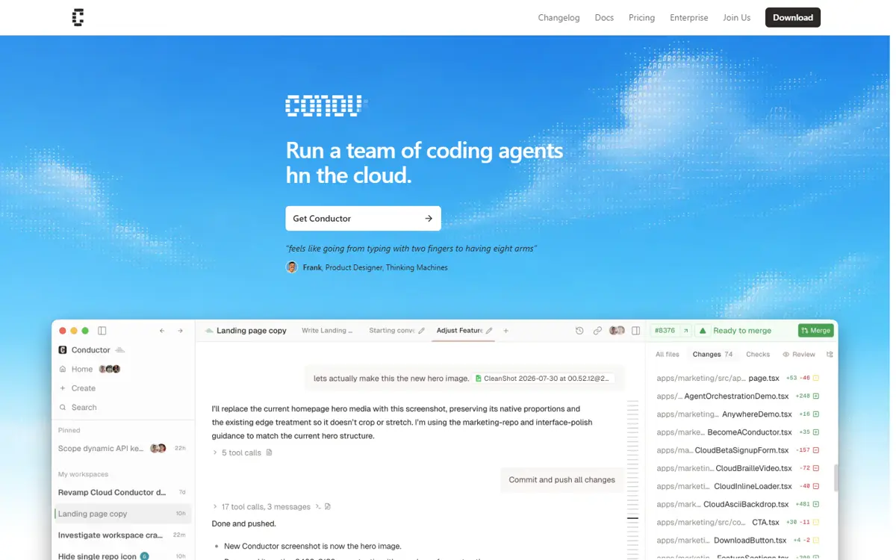
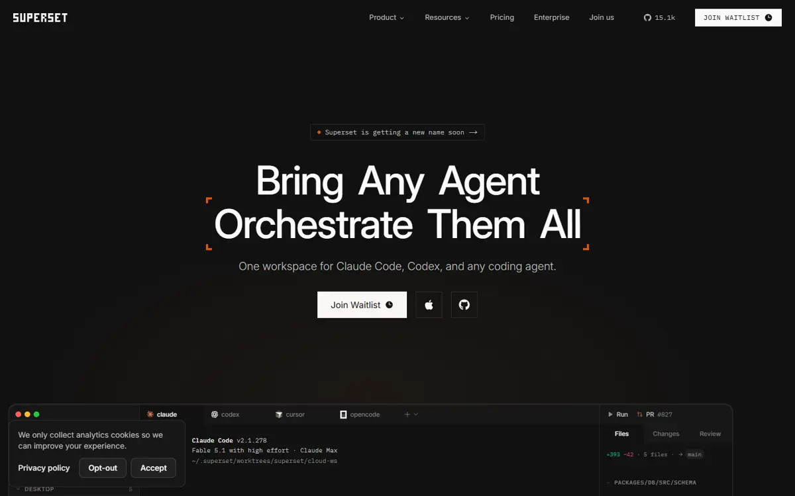
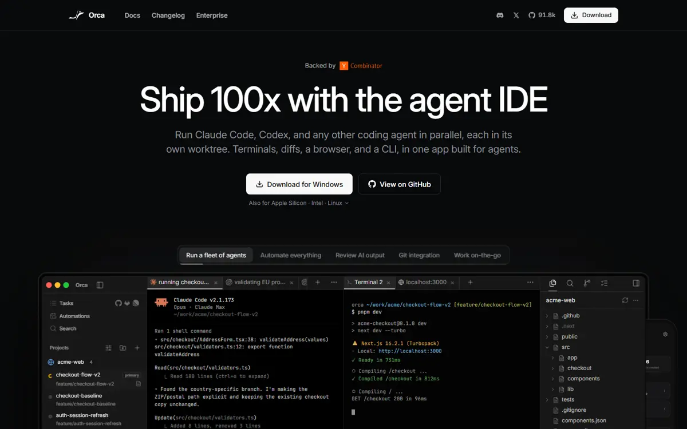
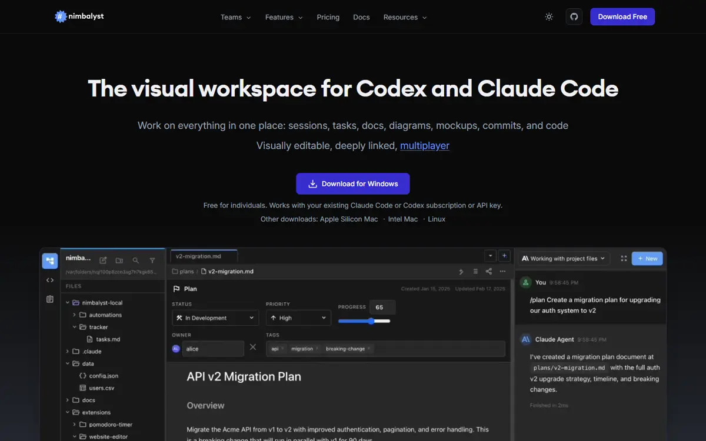
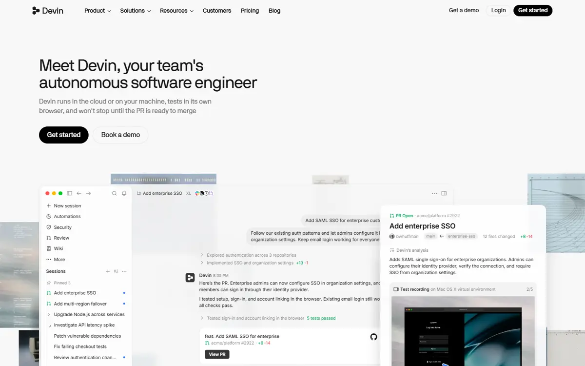
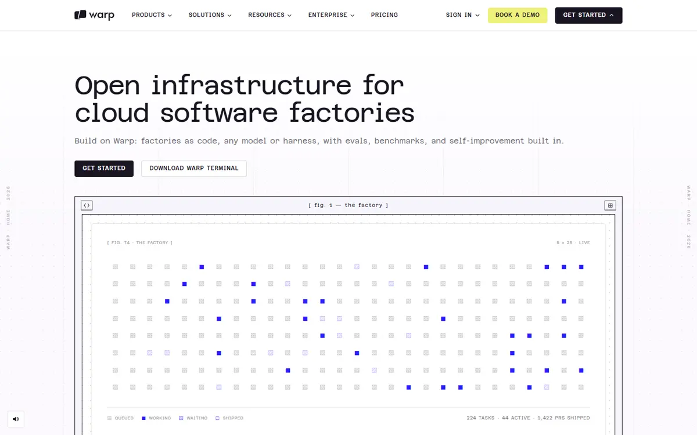
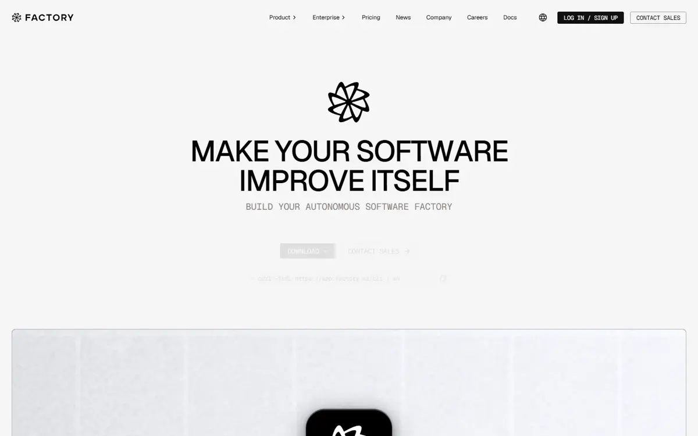
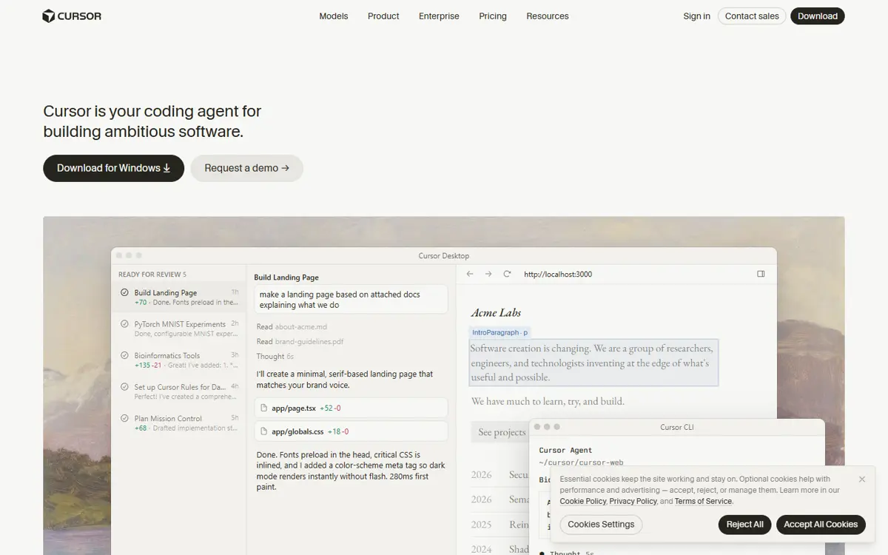

# Redesign e crescimento do Starfork — pesquisa completa

> Para: Douglas · De: Kelvin · Pesquisa feita em 14/10/2026.
> Nada aqui foi implementado: é material para decidirmos juntos o que fazer e em que ordem.

## Por onde começar

Se você tem **10 minutos**, leia o [ANALISE-E-PLANO.md](ANALISE-E-PLANO.md) (plano de produto e design) e o [07-plano-marketing.md](07-plano-marketing.md) (como conseguir clientes).

| Arquivo | O que tem |
|---|---|
| [ANALISE-E-PLANO.md](ANALISE-E-PLANO.md) | **Plano de produto e design.** Diagnóstico, benchmark visual, plano em 5 fases com os porquês, riscos |
| [07-plano-marketing.md](07-plano-marketing.md) | **Plano de marketing.** Posicionamento, ICP, preço, funil, canais, FOMO honesto, plano de 90 dias, mensagens prontas |
| [01-diagnostico-sites.md](01-diagnostico-sites.md) | Landing e app do Starfork seção por seção, e a referência de acabamento visual destrinchada (efeitos, fontes, paleta) |
| [02-concorrentes.md](02-concorrentes.md) | 12 concorrentes: posicionamento, landing, preço, sinais de confiança, UX para copiar |
| [03-reclamacoes.md](03-reclamacoes.md) | As 10 maiores reclamações dos usuários, com as fontes, e o placar do Starfork |
| [04-redes-e-anuncios.md](04-redes-e-anuncios.md) | O que falam no Reddit/X (link de cada post), quem anuncia e como (link de cada anúncio), conteúdo em alta no Brasil |
| [05-email-couryo.md](05-email-couryo.md) | E-mail transacional e de ciclo de vida com o Couryo, passo a passo |
| [06-mercado-e-dinheiro.md](06-mercado-e-dinheiro.md) | Quem está faturando, quanto captou, quem morreu e por quê |

## Benchmark: como os concorrentes abrem a página

| | |
|---|---|
| **Conductor**  | **Superset**  |
| **Orca**  | **Nimbalyst**  |
| **Devin**  | **Warp**  |
| **Factory**  | **Cursor**  |

7 de 8 mostram **a interface real do produto trabalhando** no hero. A nossa mostra um diagrama marcado "EXEMPLO".

## Quem está ganhando dinheiro

| Empresa | Receita anual (ARR) | Valuation / evento | Fonte |
|---|---|---|---|
| **Cursor** | ~US$ 2 bi (fev/2026) | **Comprada pela SpaceX por US$ 60 bi** (ago/2026) | [Bloomberg](https://www.bloomberg.com/news/articles/2026-03-02/cursor-recurring-revenue-doubles-in-three-months-to-2-billion) · [TechCrunch](https://techcrunch.com/2026/06/16/spacex-to-acquire-cursor-for-60b-in-stock-days-after-blockbuster-ipo/) |
| **Cognition** (Devin + Windsurf) | ~US$ 900 mi (set/2026) | US$ 48 bi (set/2026) | [PYMNTS](https://pymnts.com/news/artificial-intelligence/2026/cognition-secures-48-billion-valuation-as-demand-for-ai-coding-surges) |
| **Lovable** | US$ 500 mi (jun/2026) | US$ 13,3 bi (ago/2026) | [TechCrunch](https://techcrunch.com/2026/08/12/lovable-confirms-new-13-3b-valuation-raises-another-400m/) |
| **Replit** | ~US$ 525 mi (abr/2026) [NV] | US$ 9 bi (mar/2026) | [TechCrunch](https://techcrunch.com/2026/03/11/replit-snags-9b-valuation-6-months-after-hitting-3b) |
| Bolt | ~US$ 40 mi, diz ser lucrativa [NV] | ~US$ 700 mi | [Sacra](https://sacra-pdfs.s3.us-east-2.amazonaws.com/bolt-new.pdf) |
| Warp | ~US$ 16 mi [NV] | Série B de US$ 50 mi | [Sacra](https://sacra.com/c/warp/) |
| Factory | Não divulga | US$ 5 bi (set/2026) | [Dow Jones](https://morningstar.com/news/dow-jones/202609155753/ai-software-developer-factory-gets-200-million-in-financing-round) |
| Conductor · Superset · Orca · Nimbalyst | **Não divulgam (grátis ou open source)** | Conductor ~US$ 22 mi [NV]; Superset na YC | [06](06-mercado-e-dinheiro.md) |
| ✝ Vibe Kanban · ✝ Terragon | **Encerradas** | — | [shutdown](https://vibekanban.com/shutdown) |

**Contexto:** o Claude Code passou de **US$ 2,5 bi** de run-rate em fev/2026 ([Constellation](https://www.constellationr.com/insights/news/anthropics-claude-code-revenue-doubled-jan-1)) e o Codex tem **mais de 5 mi de usuários por semana** ([Constellation](https://www.constellationr.com/insights/news/openai-touts-broadening-codex-usage-5-million-weekly-active-users)).
**Quem fatura cobra de empresas e por uso. Os orquestradores locais grátis ainda não acharam como cobrar, e dois já morreram.** Detalhes em [06](06-mercado-e-dinheiro.md).

## Anúncios dos concorrentes

| Empresa | Meta (Facebook/Instagram) | Google | Destaque |
|---|---|---|---|
| **Devin** | [~150 ativos](https://www.facebook.com/ads/library/?active_status=active&ad_type=all&country=ALL&view_all_page_id=627575257116750) | [~500 ativos](https://adstransparency.google.com/advertiser/AR16078142091833638913) | Vídeo de criador "comente DEVIN" ([exemplo, 116 dias](https://www.facebook.com/ads/library?id=1026266486443327)) · busca ["Cursor AI Alternative"](https://adstransparency.google.com/advertiser/AR16078142091833638913/creative/CR01689271394124169217) |
| **Cursor** | 0 | [~7.000 (Anysphere)](https://adstransparency.google.com/advertiser/AR14589023080010481665) · [via OMD](https://adstransparency.google.com/advertiser/AR13912486213865963521) | [Anúncio de 500–600 mil de alcance](https://adstransparency.google.com/advertiser/AR14589023080010481665/creative/CR10234034475042340865) |
| **Warp** | — | [~200](https://adstransparency.google.com/advertiser/AR11247243785886760961) | ["Best Modern Mac Terminal": 1.088 dias no ar](https://adstransparency.google.com/advertiser/AR11247243785886760961/creative/CR15187545421456080897) |
| **Nimbalyst** | 0 | [7, inativos](https://adstransparency.google.com/advertiser/AR04655727111296778241) | ["PMs use Claude Code"](https://adstransparency.google.com/advertiser/AR04655727111296778241/creative/CR08386052683437441025) |
| **Superset** | 0 | [4, testados por 2 dias e parados](https://adstransparency.google.com/advertiser/AR18365530099022823425) | "Orchestrate 100+ AI Agents" |
| **Conductor · Orca · Factory** | 0 | 0 | Crescem por indicação ou venda direta |
| **Brasil** ("agentes de IA programação") | 53 anúncios, **todos de cursos** | — | **Nenhum produto concorrente anuncia no Brasil** |

Todos os anúncios, com texto e tempo no ar: [04-redes-e-anuncios.md](04-redes-e-anuncios.md).

## As 10 conclusões mais importantes

1. **O Starfork parece "vibecodado" por fora, mas não por dentro.** O produto é grande e sério; faltam sinais de empresa (prova social, segurança, changelog, demo real) e identidade visual própria. A landing usa os tokens padrão do Tailwind/shadcn.
2. **Nas 3 maiores reclamações sobre os concorrentes, o Starfork já é a resposta**: agente que diz "pronto" sem estar (prova + gate), setup de cada worktree (`.env` copiado, `node_modules` linkado, porta livre) e gasto surpresa (estimativa em R$ + teto). A landing não diz isso.
3. **Orquestrar worktrees virou commodity grátis.** O Starfork precisa vender **"entrega com prova"**, não "agentes em paralelo".
4. **O dinheiro está em times e empresas.** Os orquestradores grátis não faturam e a Bloop morreu por ter só usuários free. Foco: tech leads brasileiros.
5. **No Brasil, nenhum concorrente anuncia.** O Google Search com termos de conquista ("alternativa ao Conductor para Windows") está livre.
6. **O formato que vende é vídeo de criador + "comente X".** O Devin mantém esses anúncios há mais de 100 dias, e criadores BR pequenos têm alcance enorme.
7. **O Conductor (o mais citado) é criticado por rodar sem sandbox.** O modo protegido é um argumento direto.
8. **Rate limit (429) é a dor frequente que ninguém resolve**, inclusive nós. É a melhor lacuna para fechar primeiro.
9. **Risco de plataforma:** a Terragon morreu quando a Anthropic e a OpenAI lançaram o recurso nativo. Defesa: multi-motor + time + prova + Brasil.
10. **Possível risco de cobrança:** usuários relatam que desde 15/06 a Anthropic cobra o `claude -p` por créditos. O nosso Modo Terminal contorna, mas precisa ser confirmado como padrão.

## Decisões que precisam de você

- [ ] Onde está o repositório da landing (ela não está neste repo)?
- [ ] Plano grátis permanente (1 projeto, 1 agente)?
- [ ] Preço do Time por assento? Preço de fundador para os 100 primeiros?
- [ ] Conseguimos 3 depoimentos reais e liberar números públicos?
- [ ] Qual modo é o padrão hoje: `claude -p` ou o Modo Terminal?
- [ ] Topa o Couryo para os e-mails?
- [ ] Orçamento de R$ 3–5 mil/mês por 2 meses para Google + criadores?

## Método

- **Sites**: capturas com Chrome headless em 1440px, HTML, CSS e JS baixados e inspecionados.
- **Concorrentes, reclamações e mercado**: buscas na web e leitura de sites oficiais, Hacker News, issues do GitHub, fóruns, Trustpilot, TechCrunch, Bloomberg, Reuters e Sacra.
- **Redes e anúncios**: [Viral Recast](https://viralrecast.com) (menções no Reddit e no X, bibliotecas de anúncios do Meta, Google e LinkedIn, conteúdo em alta). ~310 créditos.
- **Código**: conferido no `main` de 09/10 (`d5523a1`) para não propor o que já existe.
- O que não foi possível verificar está marcado com **[NV]**. Nenhuma citação ou número foi inventado.
